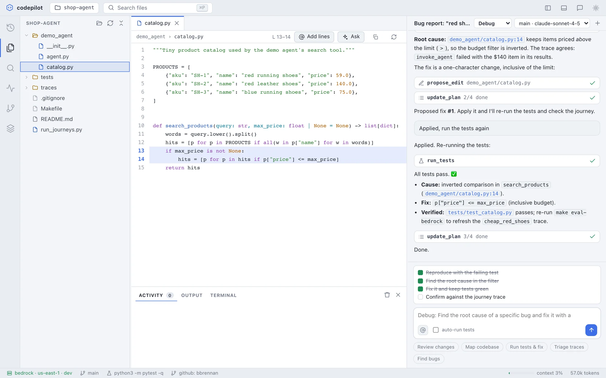
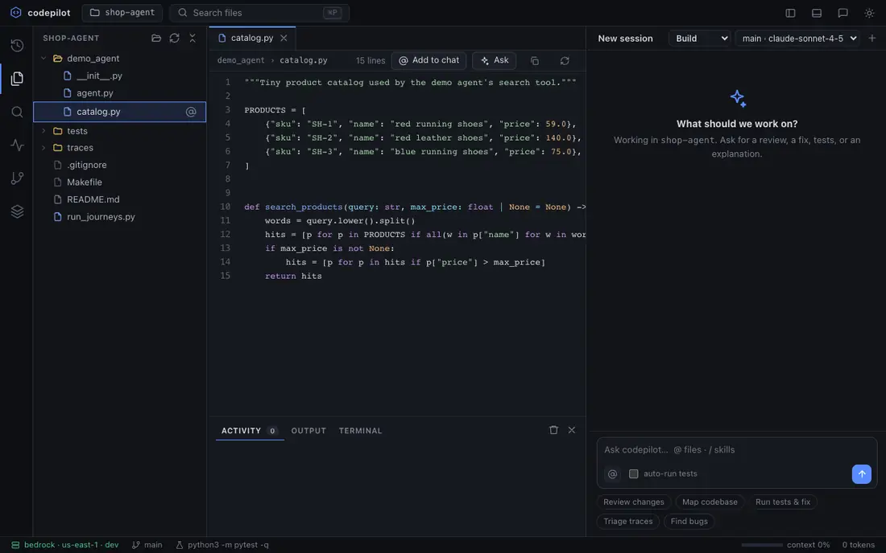
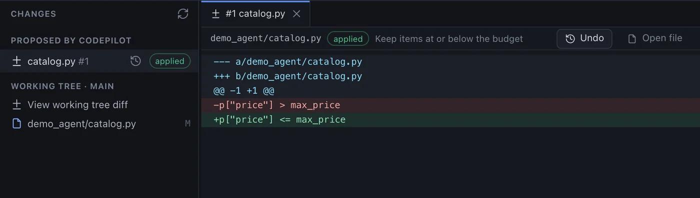
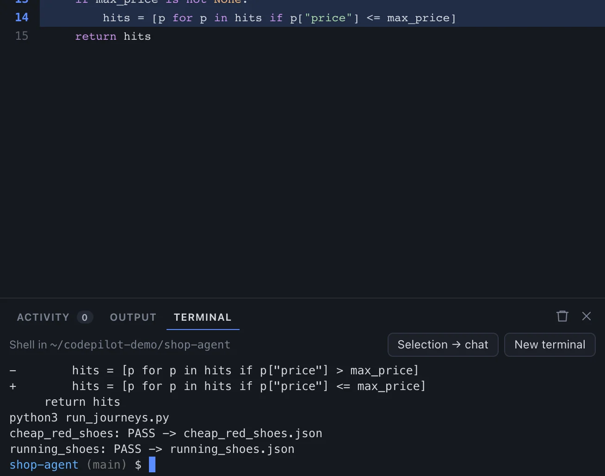
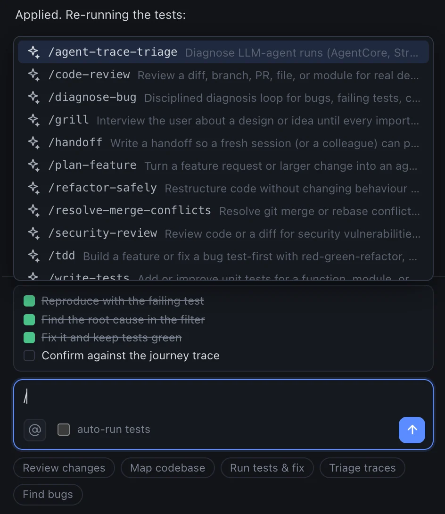
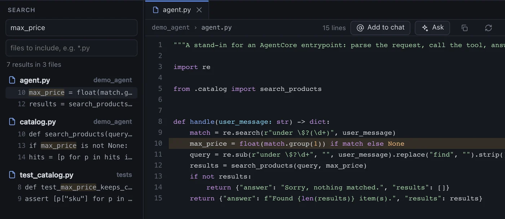
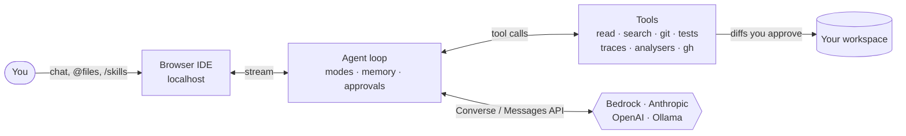

<p align="center">
  <picture>
    <source media="(prefers-color-scheme: dark)" srcset="docs/assets/banner-dark.svg">
    
  </picture>
</p>

<p align="center">
  <a href="LICENSE"></a>
  
  
  
  
</p>

<p align="center">
  <b>Point it at any folder and ask, in chat, to review code, hunt bugs, fix them, build features, or explain
  why an agent run failed from its traces.</b><br>
  Every edit is a diff you approve (and can undo). Every command asks first. It never commits or pushes on its own.
</p>

<p align="center">
  <a href="docs/setup.md"><b>Set up</b></a> ·
  <a href="docs/usage.md"><b>Use</b></a> ·
  <a href="docs/benchmark.md"><b>Benchmark</b></a> ·
  <a href="docs/security.md"><b>Security</b></a> ·
  <a href="docs/troubleshooting.md"><b>Troubleshooting</b></a>
</p>

<picture>
  <source media="(prefers-color-scheme: dark)" srcset="docs/assets/hero-dark.webp">
  
</picture>

### See it work

Reproduce → root cause → proposed diff → approve → verify, in Debug mode:

<p align="center">
  
</p>

<sub>The screenshots and animation show the real app, tools, test runs and diffs on the bundled demo project. The
assistant's replies in them are scripted so the demo is reproducible.</sub>

## What it does

- **Works like an IDE:** file explorer, tabs with syntax highlighting, search, a ⌘P file palette, git
  changes, terminals (as many as you like, and they survive page reloads), and chat docked on the right.
  Reference code with `@file` or `@file:10-40`, drag files in, or select lines and **Add to chat**.
- **Edit files yourself, too:** a File menu, new file and folder, rename, delete with undo, and a
  simple editor with Save.
- **Runs like an app:** `make start` runs it in the background in its own window, and on macOS `make app`
  installs a **Codepilot.app** for the Dock. No terminal to keep open.
- **Safe by default:** it reads freely, but every edit is a diff you **Apply** (and can **Undo**), and every
  shell command needs your approval. It never commits or pushes on its own.
- **Focused modes:** Ask, Plan, Build, Debug, Bug-hunt and Review, each a focused agent. Add your own.
- **Built for debugging:** it reproduces first (a failing test or a scratch script), tests hypotheses one at
  a time, fixes the root cause, and adds a regression test. Skills such as `diagnose-bug`, `tdd`,
  `code-review` and `security-review` are built in, and community `SKILL.md` skills work too.
- **Sees run time, not just code:** a trace viewer with span timelines for JSON/JSONL traces (AgentCore,
  OpenTelemetry, structured logs), plus optional CloudWatch Logs search.
- **Uses real tools:** linters, type checkers and security scanners (ruff, mypy/pyright, eslint/tsc,
  gitleaks, semgrep, ...) when installed; ripgrep for search; GitHub PRs, issues and CI logs through `gh`.
- **Never runs out of room:** token-accurate context management clears stale tool output and summarises
  earlier turns before the window fills, even mid-task, and recovers automatically if a request is still too
  long. `/compact` and "continue in new session" are there when you want them. Per-folder notes persist.
- **Auto model routing:** the newest Sonnet for routine work, Opus for planning, debugging and big
  changes (and as a second opinion when tests keep failing), Haiku for quick questions. It shows each pick
  and why, and the benchmark measures whether it saves money.
- **Review without losing your place:** proposed changes and command approvals wait in a bar above
  the message box. A Review tab with keyboard shortcuts, Apply all, and "always allow `pytest`" for the
  session.
- **Images:** paste or drop screenshots, link an image, or point at a file; the assistant can open images itself.
- **Trusted web tools, no MCP:** current library docs (Context7), web pages (asks per site), optional web
  search.
- **Slash commands:** `/plan`, `/debug …`, `/model opus`, `/spec …`, `/init`, `/undo`, `/export`, `/bug` and
  more, run instantly in the app.
- **Chat that keeps up with you:** while it works, Enter queues messages to run after, and ⌘Enter steers
  it (read at its next step); reloading the page doesn't stop a turn. Edit or retry
  any message, ↑ for earlier prompts, and desktop notifications when it's done.
- **Spec-driven development:** for bigger work, requirements (EARS acceptance criteria), then design, then
  tasks, each reviewed in a Spec tab, then task-by-task implementation. Includes drift checks and mapping
  eval results to acceptance criteria. It uses Kiro's format, in `.codepilot/specs/`.
- **Steering:** standing instructions it always follows, in Kiro's format (`.codepilot/steering/`):
  always on, for matching files, by `#name`, or when relevant. It drafts them from your repo, and reads
  `AGENTS.md`, `CLAUDE.md`, Kiro, Cursor and Copilot instruction files too.
- **Undo a whole turn:** checkpoints. Everything applied from a message onwards can be undone together, with
  the same guard as Undo, so edits you made since are never overwritten.
- **Verification receipts:** pending changes are tried on a copy of your workspace first (tests and analysers),
  so the review shows what they would newly break before you Apply.
- **Safer around untrusted content:** once a session has read from outside the machine (web pages, search,
  logs, GitHub), "always allow" rules pause and commands, fetches and queries ask again, with the reason.
- **Package guard:** before a command or manifest edit installs a dependency, it checks PyPI, npm and
  crates.io for packages that don't exist or look suspicious.
- **Cost meter:** dollars per session and per day, an estimate before a long run, and an optional daily cap.
- **Quick specs:** `/spec quick …` plans a medium-sized change or bug in one reviewed pass instead of three.
- **Measurable:** `codepilot bench` grades it on planted-bug tasks with hidden tests, so you can compare
  models and changes.


## A closer look

<table>
<tr>
<td width="50%"><br><b>Review every change.</b> Proposed edits are diffs you Apply or Reject; applied ones can be undone. Git status sits alongside.</td>
</tr>
<tr>
<td width="50%"><br><b>Integrated terminals.</b> As many real shells as you need, from the Terminal menu. They survive page reloads. Send any output to the chat in one click.</td>
<td width="50%"><br><b>Skills and modes.</b> <code>/diagnose-bug</code>, <code>/code-review</code>, <code>/tdd</code> and more, plus Ask, Plan, Build, Debug, Bug-hunt and Review modes.</td>
</tr>
<tr>
<td colspan="2"><br><b>Search, ⌘P and @references.</b> Find anything, open it in a tab, and reference files or line ranges in chat with <code>@path:10-40</code>.</td>
</tr>
</table>

## How it works



## Quick start

You need macOS or Linux, Python 3.11+, [uv](https://docs.astral.sh/uv/) and git.

```bash
git clone https://github.com/bbrennan/codepilot.git && cd codepilot
cp .env.example .env
make install
```

Then configure **one** provider in `.env`. Full details for each, including accounts, permissions and keys,
are in **[docs/setup.md](docs/setup.md)**.

<details open><summary><b>Amazon Bedrock</b> (Claude through your AWS account)</summary>

```bash
# .env
CODEPILOT_PROVIDER=bedrock
AWS_PROFILE=your-sso-profile
AWS_REGION=us-east-1
```
```bash
aws sso login --profile your-sso-profile
```
Needs Claude model access in Bedrock and `bedrock:InvokeModelWithResponseStream` permission
([details](docs/setup.md#amazon-bedrock)).
</details>

<details><summary><b>Anthropic API</b> (your own key)</summary>

```bash
# .env
CODEPILOT_PROVIDER=anthropic
ANTHROPIC_API_KEY=sk-ant-...
```
Create a key at console.anthropic.com ([details](docs/setup.md#anthropic-api)).
</details>

<details><summary><b>OpenAI</b> (your own key, or a compatible endpoint)</summary>

```bash
# .env
CODEPILOT_PROVIDER=openai
OPENAI_API_KEY=sk-...
CODEPILOT_OPENAI_MODEL=<a model id>      # `make doctor` lists yours
```
([details](docs/setup.md#openai-api))
</details>

<details><summary><b>Ollama</b> (free and local; for trying it out)</summary>

```bash
make ollama     # install Ollama and pull a small model
make demo       # run codepilot on the bundled demo project
```
([details](docs/setup.md#ollama))
</details>

Then:

```bash
make doctor     # checks credentials, models, GitHub and tools, and tells you how to fix anything
make serve      # opens http://127.0.0.1:8765
```

No terminal to keep open: `make start` runs it in the background, and on macOS `make app` installs a
**Codepilot.app** you can keep in the Dock ([details](docs/setup.md#run-without-a-terminal)).

Click **Open folder…** (or say "review ~/code/my-service" in chat) and go. See
**[docs/usage.md](docs/usage.md)**.

## Documentation

| Doc | What's in it |
|---|---|
| [Setup](docs/setup.md) | Prerequisites, install, every provider (accounts, IAM, keys), GitHub, analysers, `make doctor` |
| [Usage](docs/usage.md) | The UI, modes, approvals, Apply/Undo, workflows, traces, GitHub, memory, shortcuts, tips |
| [Configuration](docs/configuration.md) | Every environment variable, and where files are stored |
| [Specs](docs/specs.md) | Spec-driven development: requirements → design → tasks → implementation, bugfix specs, evals |
| [Steering](docs/steering.md) | Standing instructions: where they live, inclusion modes, writing good ones, other tools' files |
| [Skills and modes](docs/skills-and-modes.md) | Built-in skills, installing and writing skills, custom modes |
| [Benchmark](docs/benchmark.md) | Running, comparing and extending the planted-bug benchmark |
| [Security](docs/security.md) | Where your code goes, what's stored, what the assistant can and can't do |
| [Troubleshooting](docs/troubleshooting.md) | Symptom → fix tables for every provider and the app |
| [Architecture](docs/architecture.md) | How it works, and how to add tools, providers, modes and tasks |
| [Contributing](CONTRIBUTING.md) | Dev setup, tests, conventions |

## Commands

| Command | What it does |
|---|---|
| `make install` | Install or update dependencies (providers and unit-test tools) |
| `make doctor` | Check your setup |
| `uv run codepilot smoke` | End-to-end check of your provider: tool calls, a proposed fix, images |
| `uv run codepilot models --refresh` | List the models your account can use |
| `make serve` | Start the UI in this terminal |
| `make start` / `make stop` / `make restart` | Run it in the background, opened in its own window / stop it / restart it on new code |
| `make app` | macOS: install Codepilot.app (double-click to start) |
| `make chat` | Terminal chat instead of the browser |
| `make test` | codepilot's own tests (no cloud access needed) |
| `make e2e` | Browser tests that drive the real UI (`make e2e-setup` once first) |
| `make bench` / `make bench-validate` | Run or validate the benchmark |
| `make ollama` / `make demo` | Local model setup and demo |

## Status

Early and actively developed. The app has been run end to end with Ollama. The Bedrock, Anthropic and
OpenAI providers are covered by automated tests against faked SDK clients, so run `make doctor` to confirm
yours works before relying on it. Please report rough edges.

## License

[MIT](LICENSE). Bundled third-party components keep their own licences; see
[THIRD_PARTY_NOTICES.md](THIRD_PARTY_NOTICES.md).
